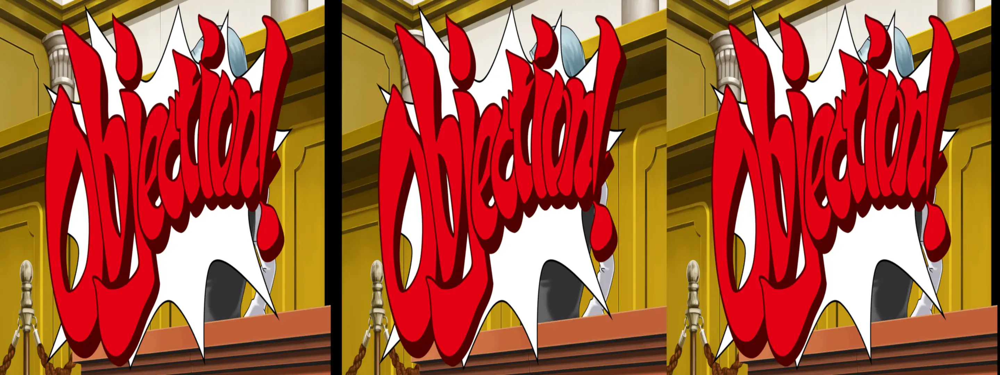
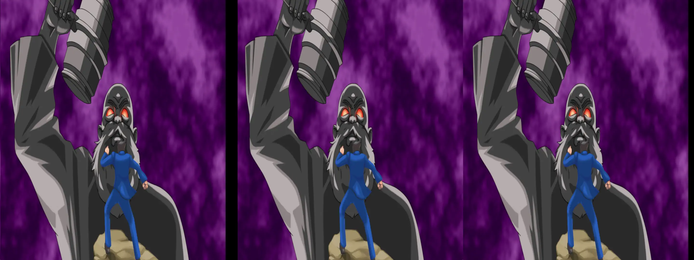
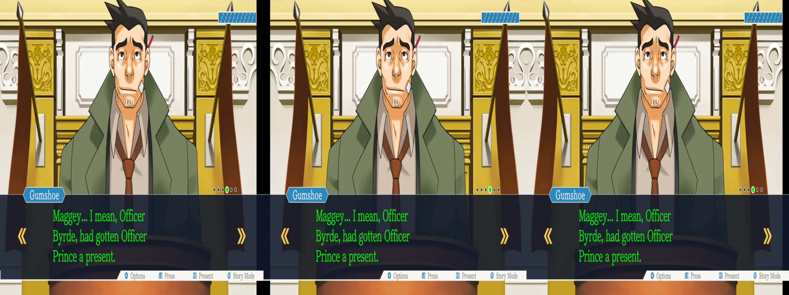

_Hey pal_, this is a:

# _Phoenix Wright: Ace Attorney Trilogy_ - geo-11 Stereoscopic 3D Fix

 _If you want to see the journey it took to get to this point, please [start here](../../../tutorials/ace-attorney-trilogy-1/README.md)_

- [Changelog](#changelog)
- [General](#general)
- [Instructions](#instructions)
- [Fixed Items and Issues](#fixed-items-and-issues)
- [Credits](#credits)
- [Thanks](#thanks)
- [LICENSE](#license)


<p align="center">
    <a href="screenshots/screenshot1.webp"></a>
</p>
<p align="center">
    <a href="screenshots/screenshot2.webp"></a>
</p>
<p align="center">
    <a href="screenshots/screenshot3.webp"></a>
</p>

## Changelog

- 1.0
  - Initial release

## General

[Store Link](https://store.steampowered.com/app/787480/Phoenix_Wright_Ace_Attorney_Trilogy/)

[PCGW](https://www.pcgamingwiki.com/wiki/Phoenix_Wright:_Ace_Attorney_Trilogy)

> [!NOTE]
> This fix is only compatible with the Steam release!  The Windows Store version is untested, and may require additional work

Fix was created for the following build number of the game's executable:

- `2017.4.8.47092`

Fix was tested with the following version(s) of geo-11:

- `v0.7.11`

If either of these items change due to updates, this fix may no longer work.  Any updates to this fix will be posted to [the repo](https://github.com/BigRobotBil/3d-releases/blob/main/Fixes/geo-11/Ace-Attorney-Trilogy-1/) it was downloaded from.

This fix was tested in the following environments and performed as expected in relation to the display type:

- Samsung Odyssey G9 G90XF
- LG 55UH8500
- Sony KDL-50W800C
- Hisense PX3-PRO
- New Nintendo 3DS

An Nvidia 5070 Ti was used to test/develop this fix.  Other brands/models are untested.

## Instructions

- geo-11 `v0.7.11` is included in this archive

Download the `7z` archive [included in this folder](./geo11_ace_attorney_trilogy_one_1.0.7z).

Navigate to the game's executable `PWAAT.exe`:

`<path to your Steam library>\steamapps\common\Phoenix Wright Ace Attorney Trilogy`

Place all files within this archive in the same directory.  Meaning in the same folder as the game's main executable, you should now have `d3dx.ini`, `nvapi64.dll`, `ShaderFixes\`, etc.

Adjust settings in-game or within the `d3dxdm.ini` to your liking, which includes the output method. By default, it is set to side-by-side output (`sbs`).

> [!WARNING]
> In my testing, geo-11's `simulated_reality` mode does not work with this game. If playing on a LeiaSR display, please use either [3DGameBridge](https://github.com/JoeyAnthony/3DGameBridgeProjects) or [SRLoom](https://github.com/effcol/SR-Loom)

### Control Setup

The following key/controller bindings are active:
- Cycle through background depth values (`0.6` - `1.0`)
  - Header: `KeyBackgroundDepth`
  - `1` (in the number row)
  - This is not mapped to a controller button
- Cycle through Character Portraits/Mid-level depth values (`0.1` - `0.5`)
  - Header: `KeyCharacterDepth`
  - `2` (in number row)
  - This is not mapped to a controller button
- Cutscene toggle
  - This puts backgrounds and characters/mid-level items at the same depth
  - Header: `KeyCutscene`
  - `3` (in number row)
  - `Left Stick Button`/`L3`
- General interactables toggle
  - For any interactable objects that are not picked up correctly by the filters I've made, so they're less painful to look at
  - `4` (in the number row)
  - `Right Stick Button`/`R3`

If you would like to permanently change the default depth for the characters and backgrounds to a specific value so you don't have to set it every time you boot the game, please edit the following variables under the `[Constants]` section:

```ini
; Background depth multiplier
z20=0.8

; Character depth multiplier
w20=0.3
```

Key bindings can be adjusted by editing the relevant sections in the `d3dx.ini` file.

> [!NOTE]
> Please reference <a href="https://learn.microsoft.com/en-us/windows/win32/inputdev/virtual-key-codes">the list of Virtual Keycodes</a> for precise mapping

## Fixed Items and Issues

_Phoenix Wright: Ace Attorney Trilogy_ has depth added to it to make it appear like a pop-up book and/or paper cut outs. The game lacked any sort of stereo/depth to begin with.

Adds the following:
- Depth to characters and backgrounds

Remaining issues:
- Testimony fly-ins ("Witness Testimony," "Cross Examination," etc) are at character/mid-level depth, and due to how they are generated by the game, they cannot be changed
  - It doesn't look _that_ bad in practice, and they disappear pretty quickly
- Interrogation rooms have the window duplicated as both part of the background and part of the middle layer
  - You can enable an override to effectively merge them into one by uncommenting the `[TextureOverride_InterrogationWindow_<1080 or AllRessBut1080>]` block in `SpecificObjectOverrides.ini`. However, characters behind the glass will weirdly be outside of it
  - Alternatively, you can use the toggle to merge the character and background layers temporarily if it's distracting
- Various cutscenes use the mid-level layer that I used for characters to display animations, and will appear incorrectly
  - Use the cutscene toggle described in the controls section
  - There are far too many in the game to make dedicated overrides than I have patience for
    - (I am just some guy on the internet, man)
- Certain items on screen will kill 3D for that moment (notably, the Court Record)
  - While 3D would engage again once these elements disappeared, I wanted to not have to resort to this. Perhaps in the future I'll figure out a better solution

Because there are so many different interactable items in this game, I only spot checked a select number of places. I did make filters for the ones I came across, but without playing the entire game again, I'm certain I've missed some. There are two overrides contained in the `BackgroundLevelOverrides.ini` that are under the headers:

- `[TextureOverride_EverythingCouldBeBadBC1]`
- `[TextureOverride_EverythingCouldBeBadBC3]`

This will affect all other interactable items, _in theory_. I have only briefly tested it, so I'm not sure what other impacts it will have. By enabling it using the toggle above, other parts of the UI may break, unfortunately. Without replaying the game, and dumping _every single texture_, I don't think it'd be feasible to have all this in unless there was a crowd effort to do so.

(by all means, if you have some texture overrides, we can add those to the fix. Or if there's just a better way than what I've done, I'm completely open to that as well)

## Credits

- Adjustments for all additions created by Zeek

## Thanks

- Masterotaku for answering my questions _yet again_. I probably would have been stuck on this fix for awhile without your help!
  - This was also heavily inspired by the work done to create the [Cuphead](https://helixmod.blogspot.com/2017/12/cuphead.html) fix!
- Members of the HelixMod community that have made fixes over the years.  Even without that much direct documentation (and myself knowing nothing about shaders at all), it really wasn't too difficult to start putting pieces together after going through created fixes

## LICENSE

- For any fixes/patterns/whatever that I have created directly within this archive, do whatever you want.  Please reference the [Beerware license](https://fedoraproject.org/wiki/Licensing/Beerware) (but with me instead) for more information
    - If you learn something, that's all that matters.  If you want to give me credit for something, that's `pretty neat`
- For any fixes/patterns included from other individuals, please reference their release information for how they should be attributed and/or reused

----Zeek/BigRobotBil