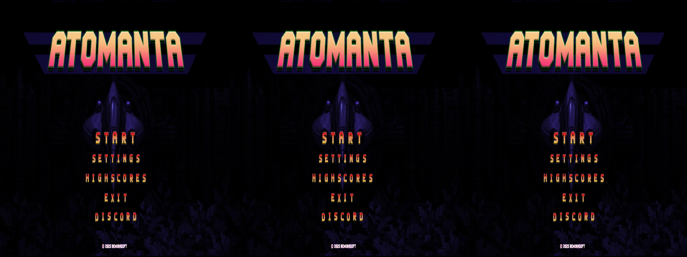
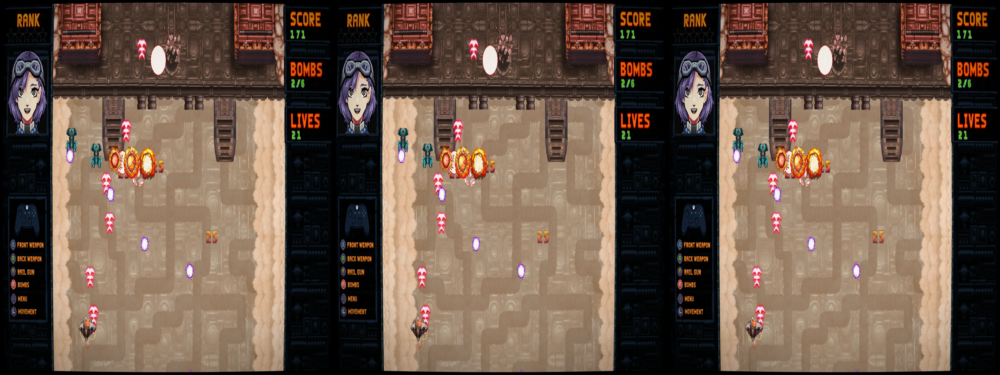
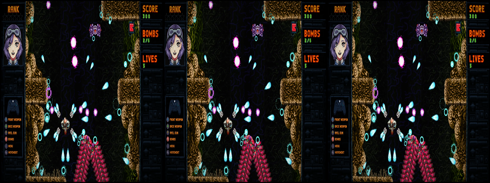

# _Atomanta_ - geo-11 Stereoscopic 3D Fix

- [Changelog](#changelog)
- [General](#general)
- [Instructions](#instructions)
- [Fixed Items and Issues](#fixed-items-and-issues)
- [Credits](#credits)
- [Thanks](#thanks)
- [LICENSE](#license)


<p align="center">
    <a href="screenshots/screenshot1.webp"></a>
</p>
<p align="center">
    <a href="screenshots/screenshot2.webp"></a>
</p>
<p align="center">
    <a href="screenshots/screenshot3.webp"></a>
</p>

## Changelog

- 1.0
  - Initial release

## General

[Store Link](https://store.steampowered.com/app/3458340/Atomanta/)


Fix was created for the following build number of the game's executable:

- `1.0.0.0`

Fix was tested with the following version(s) of geo-11:

- `v0.7.11`

If either of these items change due to updates, this fix may no longer work.  Any updates to this fix will be posted to [the repo](https://github.com/BigRobotBil/3d-releases/blob/main/Fixes/geo-11/Atomanta/) it was downloaded from.

This fix was tested in the following environments and performed as expected in relation to the display type:

- Samsung Odyssey G9 G90XF
- LG 55UH8500
- Sony KDL-50W800C
- Hisense PX3-PRO
- New Nintendo 3DS

An Nvidia 5070 Ti was used to test/develop this fix.  Other brands/models are untested.

## Instructions

- geo-11 `v0.7.11` is included in this archive

Download the `7z` archive [included in this folder](./geo11_atomanta_1.0.7z).

Navigate to the game's executable `Atomanta.exe`:

`<path to your Steam library>\steamapps\common\_stand-alone_executable`

Place all files within this archive in the same directory.  Meaning in the same folder as the game's main executable, you should now have `d3dx.ini`, `nvapi64.dll`, `ShaderFixes\`, etc.

Adjust settings in-game or within the `d3dxdm.ini` to your liking, which includes the output method. By default, it is set to side-by-side output (`sbs`).


### Control Setup

The following key/controller bindings are active:
- Cycle through HUD pop-up level (`0` - `0.5`)
  - Header: `KeyHUDPopOut`
  - `1` (in the number row)
  - `Left Stick Button`/`L3`
- Cycle through separation/convergence presets (`50/200`, `25/2`)
  - Header: `KeyViewPresets`
  - `2` (in the number row)
  - `Right Bumper`/`R1`

If you would like to permanently change the default pop out for the HUD to a specific value so you don't have to set it every time you boot the game, please edit the following variables under the `[Constants]` section:

```ini
; HUD depth
z20 = 0.2
```

Key bindings can be adjusted by editing the relevant sections in the `d3dx.ini` file.

> [!NOTE]
> Please reference <a href="https://learn.microsoft.com/en-us/windows/win32/inputdev/virtual-key-codes">the list of Virtual Keycodes</a> for precise mapping

## Fixed Items and Issues

_Atomanta_ generally works without issue. The layering of the sprites and backgrounds is given depth by geo-11 without having to manually push things around.

Adds the following:
- Adds pop out to text/side panels
  - I can best describe this as an arcade cabinet sort of feel
    - If you pair it with [ShaderGlass](https://github.com/mausimus/ShaderGlass) and some kind of CRT filter, it gets you most of the way there!

Remaining issues:
- Enemies and missiles are at different levels, but it's not really distracting
  - This seems to be rooted in how the engine layers the sprites (I tried to adjust it, but we'll just say it didn't go well)
- 3D is disengaged during the menu selection, but will suddenly come back right after selecting an option. The image I tried to use to mark if the selection screen was active wasn't good

## Credits

- Adjustments for all additions created by Zeek

## Thanks

- Members of the HelixMod community that have made fixes over the years.  Even without that much direct documentation (and myself knowing nothing about shaders at all), it really wasn't too difficult to start putting pieces together after going through created fixes

## LICENSE

- For any fixes/patterns/whatever that I have created directly within this archive, do whatever you want.  Please reference the [Beerware license](https://fedoraproject.org/wiki/Licensing/Beerware) (but with me instead) for more information
    - If you learn something, that's all that matters.  If you want to give me credit for something, that's `pretty neat`
- For any fixes/patterns included from other individuals, please reference their release information for how they should be attributed and/or reused

----Zeek/BigRobotBil