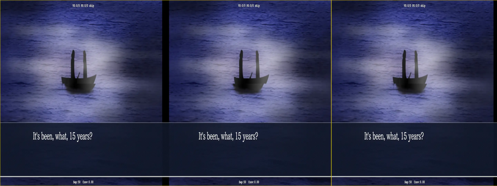
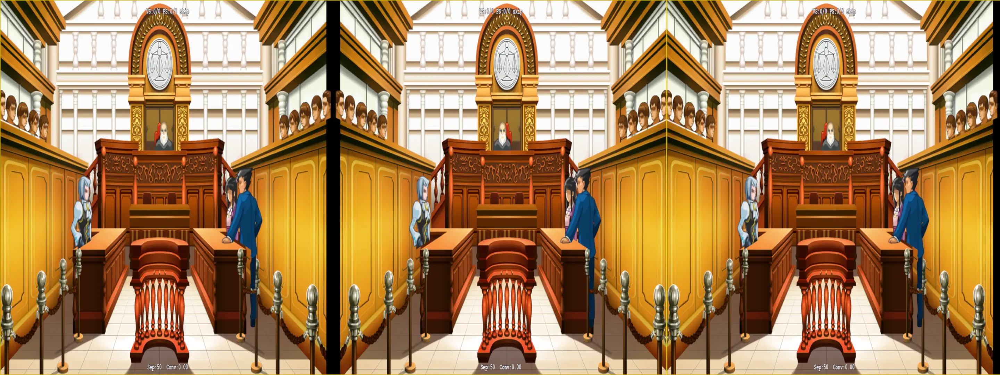

# Cutscenes

_AA_ has cutscenes at the opening of every case, as well as sometimes during the case. How the game performs them is by using what I've made the "character layer" be the animation itself. As you can already guess, this has the negative impact of doing this:

<p align="center">
    <a href="figuringscreens_cutscenes/figuringscreens_broken_cutscene.webp"></a>
</p>

Similarly, the same thing happens during the trial segments when someone is presenting where the killer was on a map, or something of the sort (though in these cases, provided the affected textures are just the victim "V" and killer "K" bubbles and not anything else on the diagram, _it's largely ok_). To mitigate this, we have two options:

- Make a specific texture override for the cutscene background and/or animation textures
- Create a _toggle_

I have done both cases in this fix, since it was just the easier thing to do for one of these.

## Dumping Textures

The "Court Room Chatter" segment when a trial begins or comes back from recess has all the animations and characters, as you would expect, at the character layer. So for a brief moment before the gavel comes down, our eyes are treated with this abomination:

<p align="center">
    <a href="figuringscreens_cutscenes/figuringscreens_broken_courtchatter.webp"></a>
</p>

Given that this specific instance is common across all three games, I figured it could be our _one_ case of actually dumping two texture hashes and making an override:

```ini
; Courtroom Chatter BG - !1080p hash
[TextureOverride_CourtChatterBG_AllResBut1080]
Hash = c1be0626
filter_index = 309

[TextureOverride_CourtChatterBG_1080]
Hash = bba08212
filter_index = 309
```

To fix the actual issue, originally I had a setup in the `d3dx.ini` to move the character/backgrounds to the same `0.5` depth. Something like this:

```ini
[PresetSameLayer]
transition = 100
transition_type = cosine
release_transition = 500
release_transition_type = cosine
z20 = 0.5
w20 = 0.5
```

And that of course worked. But it also "broke" some trust with the user: the user already set their background/characters to _something_, and now I'm just changing it to something _I_ think is good for that brief time (just ignore the rest of what I change to make the game look good to me for a moment). What we can do instead here is map the values to one that the user already setup:

```ini
; z20 is the background depth. w20 is the character depth
[PresetSameLayer]
w20 = z20
```

(The background is likely the safer bet to move everything for abrupt transitions, I think anyway)

This will do that for us, and also reset it properly due the nature of how presets work in geo-11. Originally I bumbled around with a conditional like this on the affected shader override:

```ini
if (ps-t0 == 309)
  w20 = z20
endif
```

But this wouldn't reset properly unless we also saved/redefined the variable in the `[Present]` section (which is something I learned when fixing [Mirage Feathers](./../mirage-feathers/figuringthingsout_conditionaltexture.md#setup) before I went with using a `preset` setup like here instead (and then ultimately [abandoning that](./../mirage-feathers/figuringthingsout_conditionaltexture.md#video-games-are-toys-for-children) for other reasons)). By using the `PresetSameLayer` approach on the shader override, that will remember the original value of `w20`, our character layer, and restore it once the conditional that made this change happen goes away (the court background for the chatter segments being unloaded).

```ini
[PresetSameLayer]
w20 = z20

[ShaderOverride_Everything]
Hash = dc88077eb60add33
x10 = ps-t0
if (ps-t0 == 8675)
  ; something like the court record has appeared
  ; The items that are selectable get caught in the Interactables filter
  ; There may be a way to preserve 3D, but this was the easiest thing to do
  preset = No3D
endif
if (ps-t0 == 309)
  ; use a preset so it resets the variables for us afterwards
  preset = SameLayer
endif
```

## Mr. Todd Gal

Now, for the rest of the backgrounds in the game, _we could_ dump them all, make specific texture hash overrides, and be done "properly" with it. But, man, I don't want to do that. So everyone gets my favorite thing in the world to make, a `toggle`:

```ini
[KeyCutscene]
Key = 3
Key = XB_LEFT_TRIGGER
type = toggle
w20 = z20
```

Surprisingly, _AA_ uses basically all the buttons on a controller, so mapping to `Left Trigger` has _some_ overlap with the actual game. Generally, as a someone making a fix, you want to avoid that so the `user experience` is streamlined, but with the other commands I wanted map at all times, the left trigger was the path of least resistence, and felt "right enough" to me. A user can, of course, change the mapping to something they find better later on.