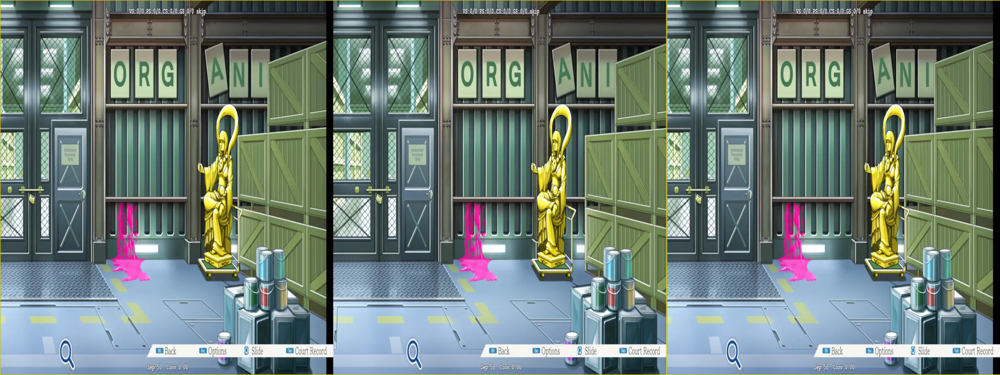
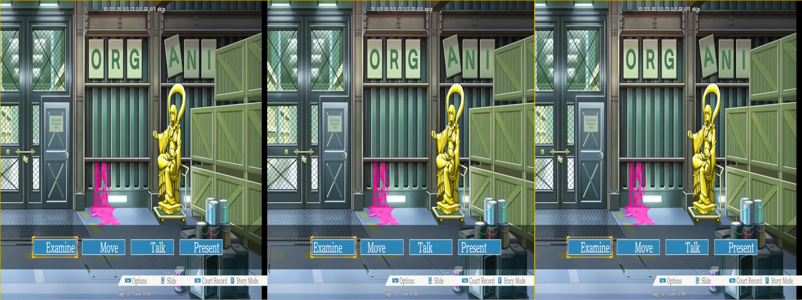
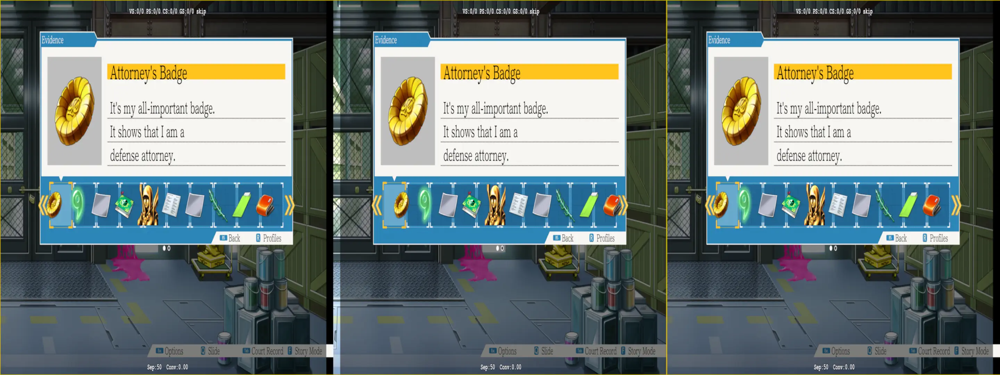

# Matching More Specific Texture

While the filters setup in the previous markdown got us pretty far, there's still plenty of nitpicking we need to do to get the game "mostly ok" to "mostly good." Namely there's UI elements and other, miscellaneous textures that don't happen to get caught up in the filter (_or_ there's textures that get caught in the filter that need to be adjusted differently).

I am not going to go over _every_ example here, but some of the major ones that popped up. You can view the finished `ini` files in the `TextureOverrides` folder that's included in the fix for all of them.

<sub>I want to say my notes in there are good, but, well, I am a bit biased</sub>

## Interactable Objects

<p align="center">
    <a href="figuringscreens_matchingmorespecifictextures/figuringscreens_interactables_broken.webp"></a>
</p>

This screen is hard to look at, and there's no real good way to mitigate other than to move these objects to the same depth as the background. Dumping this scene, we can see that the textures are all over the place for this, which isn't a good sign. However, if we press on anyway, we can apply:

```ini
[TextureOverride_Interactables]
match_type = Texture2D
match_format = R8G8B8A8_UNORM
match_bind_flags = -render_target -depth_stencil
filter_index = 30
```

And, everything looks fine there--

<p align="center">
    <a href="figuringscreens_matchingmorespecifictextures/figuringscreens_broken_selection.webp"></a>
</p>

Er, whelp. What we have to decide is if we want to hardcode for all the various interactable objects (warranting having to _play_ this entire three game trilogy again) or do the opposite: assuming everything but the menu system needs to be pushed in. Since I am from the future, I went with the latter:

```ini
[TextureOverride_Interactables]
match_type = Texture2D
match_width = !332
match_height = !294
match_format = R8G8B8A8_UNORM
match_bind_flags = -render_target -depth_stencil
filter_index = 30
```

That width/height matches the selection dialog texture, and now:

<p align="center">
    <a href="figuringscreens_matchingmorespecifictextures/figuringscreens_broken_courtrecord.webp"></a>
</p>

_This is gonna take awhile, huh_

What we're going to have to do from this point on is assign textures we come across that shouldn't be caught up in the filter a specific `filter_index` so they don't get pushed to a depth we don't want. So for example, the item highlight box:

```ini
[TextureOverride_ItemHighlight]
match_type = Texture2D
match_width = 450
match_height = 450
match_format = R8G8B8A8_UNORM
match_bind_flags = -render_target -depth_stencil
filter_index = 99
```

However, all of this banks on that there isn't going to be a texture with the same exact properties floating around that we _want_ to push somewhere else. Chances are, there might be cases that we just have to suffer and make specific texture overrides for the [two different hashes](./figuringthingsout_matchingtextures.md#the-texture-hashes-are-different-between-resolutions). But, we can hope it won't be too many.

## Is This a Good Idea?

Being that I'm from the future while I write all this, the method I ended up going with was capturing all textures except for the animation layer of the character portraits. Thus, using the selection boxes was not a good move. However, at the same time, this entire process is a risk:

<p align="center">There can easily be textures that get caught up in the filter that shouldn't</p>

We've already seen this happen since I changed from the selection boxes.

What I am doing is having to walk the line of what is easier to deal with:
  - Map every texture manually
  - Capture them all and do it in reverse

Both have their pros and cons. Dumping every texture and assigning it is the "correct" thing to do, as that ensures we'll capture everything and place it on the layer we want. However, that is utterly tedious and timeconsuming (especially since we need to do [two passes](./figuringthingsout_matchingtextures.md#the-texture-hashes-are-different-between-resolutions)). Doing the reverse just has the annoyance that we may not know if we missed one unless we play through the whole game again (which I'm not going to do), _or_ even worse that something we make an exception for as we're going through will affect _something else_ we've already verified as fixed. I'm just spot checking places where I know the game does stuff a bit differently here and there ("videos," cutscenes, dynamic close ups, etc). Chances are, if this truly is the path I go down, there's a pretty high chance I release this with a broken texture somewhere. While I want to avoid that, it's going to be tough.

But, who knows, maybe someone out there will actually download this fix and play the game with it and report back. I specifically chose _AA_ because of it wide appeal as my test bed for this pop-up book approach. Namely as the other VNs I would have considered probably wouldn't have the name recognition as _AA_ does as a decent "my first VN" game. I've already gotten feedback on [t](./../../Fixes/geo-11/StudioSystem-GuardianAngel/README.md)[w](./../../Fixes/geo-11/Mirage-Feathers/README.md)o of my fixes from developers that they thought it was cool, and that was enough for me, though. But if someone actually plays this, that'd be `pretty neat`.

---

## Narrator: It Was Probably Not a Good Idea

Being from the future, I've buttoned up the fix as much as I am comfortable rebooting this game and its various chapters. One fix broke another, and it took some time to find an equilbrium. The problem is just that _AA_ has a lot more interaction, and not a lot of clean breaks between different items (backgrounds/characters/interactables), so it's easy for one to end up in the layer of another. Because I do not want to dump textures, however, I went ahead and made an "oh shi---" toggle to address anything lingering in case I get hit by a bus:

```ini
[Constants]
x50=0

[TextureOverride_EverythingCouldBeBadBC1]
match_type = Texture2D
match_format = BC1_UNORM
match_width = <433
match_height = <433
filter_index = 31

[TextureOverride_EverythingCouldBeBadBC3]
match_type = Texture2D
match_format = BC3_UNORM
match_width = <433
match_height = <433
filter_index = 31

[KeyInteractablesToggle]
Key = 4
Key = XB_RIGHT_THUMB
type = cycle
x50 = 0, 1

[ShaderOverride_Everything]
Hash = dc88077eb60add33
x10 = ps-t0
```

```hlsl
// within dc88077eb60add33
  float4 interactableToggle = IniParams.Load(int2(50,0));
  ...
  else if (texFilter.x == 31 && interactableToggle.x == 1) {
    // for this to be active, the user has to hit the trigger for the toggle
    o0.x += stereo.x * depthMultiplier.z;
  }
```

Interactable objects can effectively be in three formats:
- BC1_UNORM
- BC3_UNORM
- R8G8B8A8_UNORM

The first part of this markdown detailed the steps done for the `R8G8B8A8_UNORM` format, and this was the one that is used by _many_ objects, as well as most of the general UI. However, of course, there's still some that end up in the other formats, and they can appear just on the backgrounds like you'd expect, or in hover overs when characters are talking about a specific piece of evidence. While I would love to nail all of them down, that isn't going to happen (especially with the requirement that we have to do two passes to grab the 1080p variant). So, unfortunately, unless we want to have a crowd sourced list of _all_ items in the game, and do some if checks if the items are being used in certain locations, I don't think this is going to end well.

At the very least, in my testing, I have not come across an interactable object that has the exact same dimensions