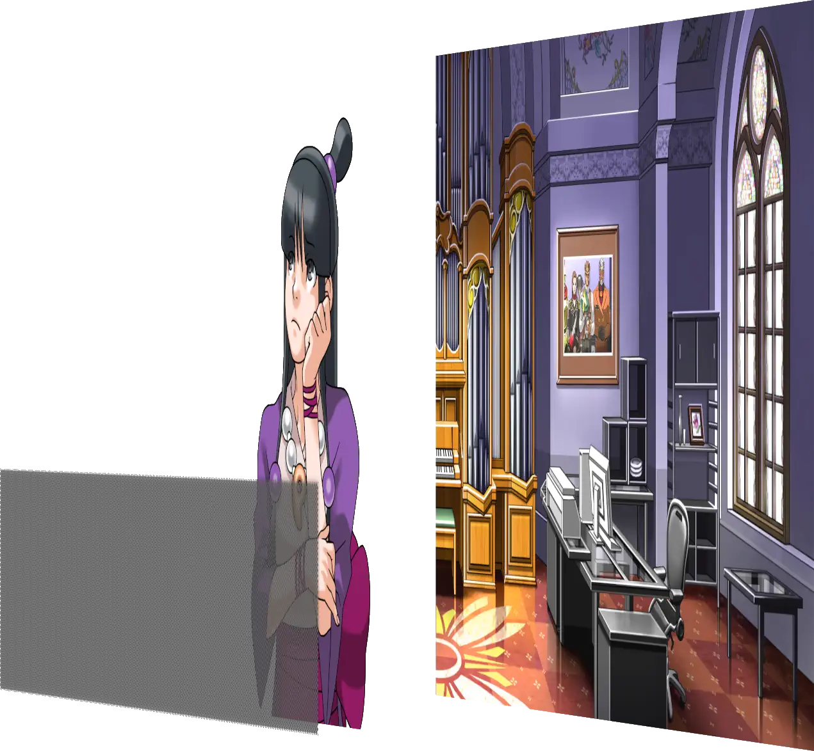
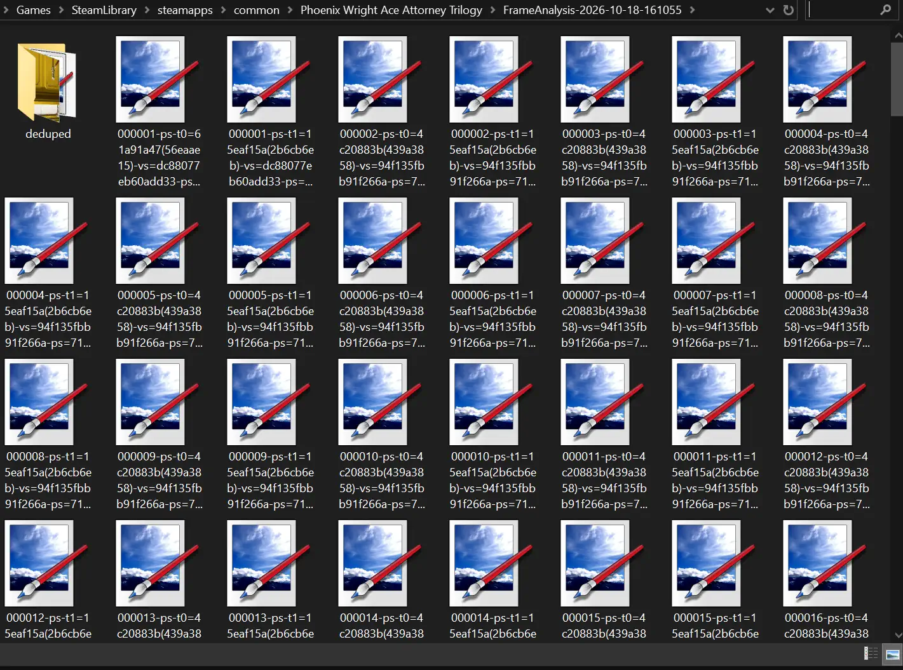
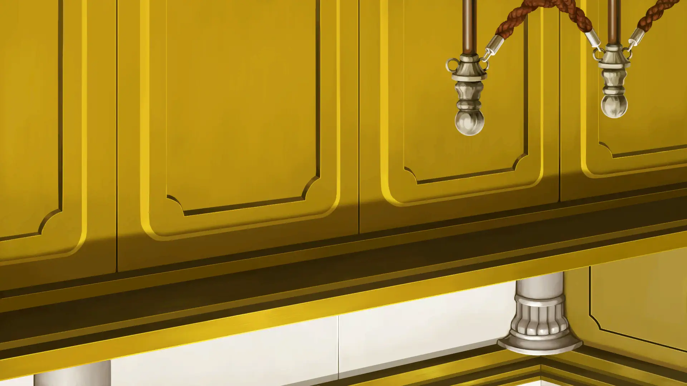
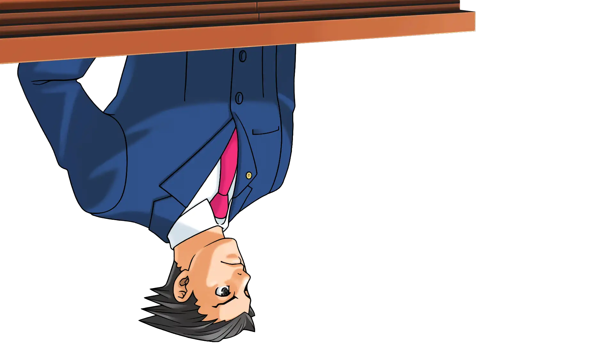
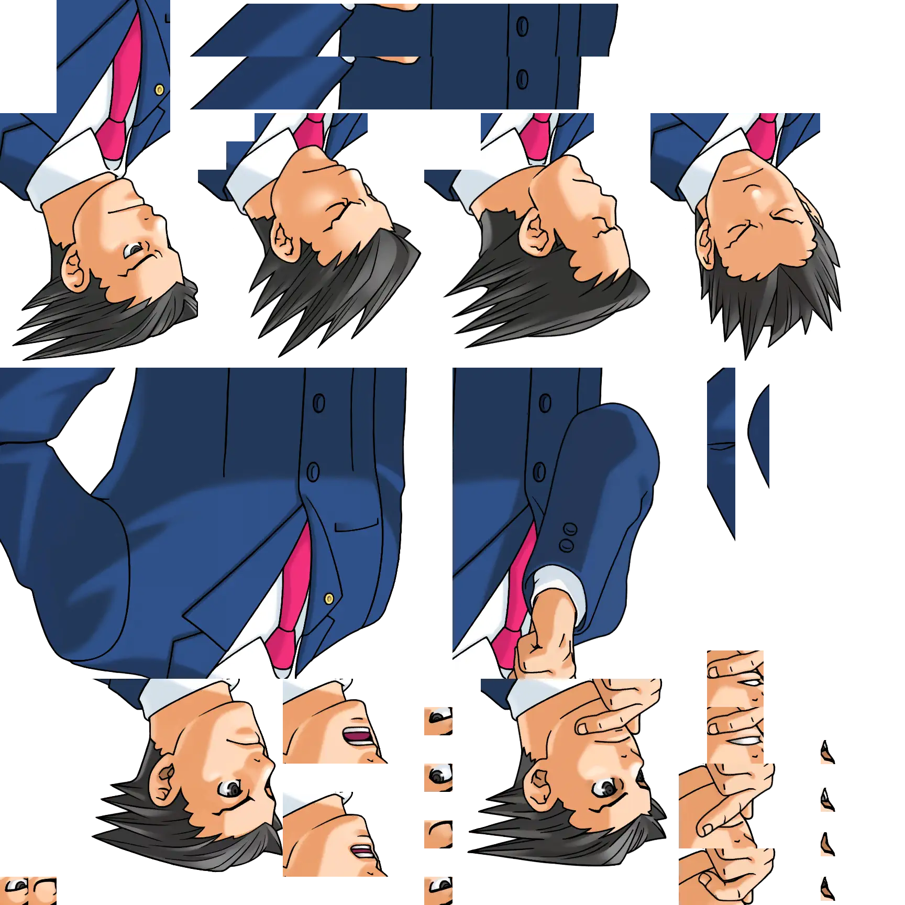
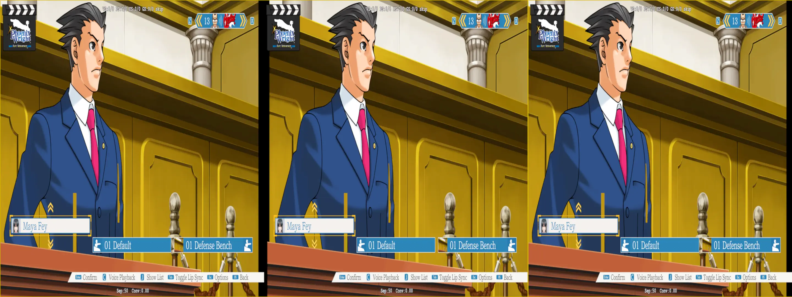
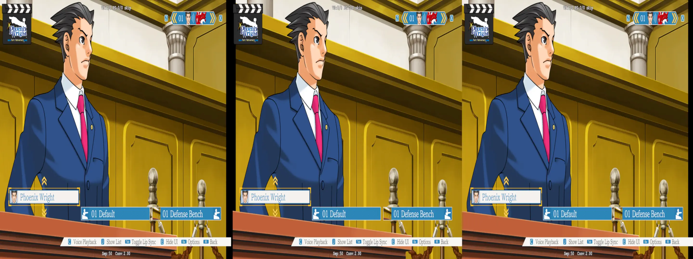
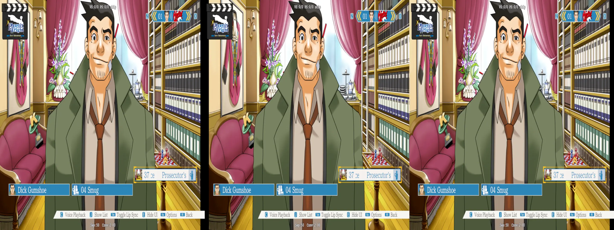
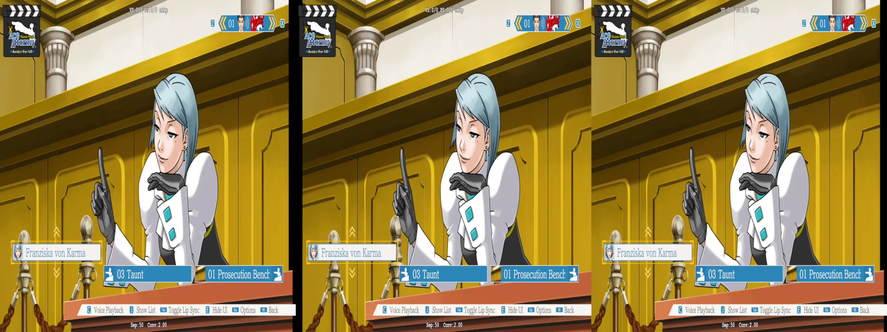

# Matching Textures

In other fixes detailed here, I went and dumped textures to make glorified booleans. This allowed us to trigger different 3D effects based on the presence of them. Now, for a game that is _completely_ flat, we have to make the 3D ourselves. This could be viewed as an extension of leveraging the `adjust_from_depth_buffer`, but we can take a much simplier approach:

```hlsl
o0.x = stereo.x * <some number>
```

or

```hlsl
o0.x = stereo.x * stereo.y * <some number>
```

Before even getting to the 3D however, the vision I have is something along the lines of this:

<p align="center">
    <a href="figuringscreens_matchingtextures/wanted_style.webp"></a>
</p>

Where the dialog is at the forefront, then the character portraits, and finally the background.

## Trials and Tribulations

To begin with, the first instinct is to dump textures, see what their hashes are, and see if we can push them into depth at all. My first attempt was with another VN, and I was able to achieve it with this simple setup:

```ini
;10 is backgrounds
[TextureOverride_RoofSunset]
Hash=0a351a6e
filter_index=10

;20 is characters/middle
[TextureOverride_SoneDefaultIdle]
Hash=0763b838
filter_index=20

[TextureOverride_AoiEnthralled1_NormalColor]
Hash=c188677c
filter_index=20

[ShaderOverride_Everything]
Hash=f7751cb99529458e
x10 = ps-t0
```

```hlsl
  float4 stereo = StereoParams.Load(0);
  float4 texFilter = IniParams.Load(int2(10,0));

  if (texFilter.x == 10) {
    // background
    o0.x += stereo.x * 0.8;
  }
  else if (texFilter.x == 20) {
    // character
    o0.x += stereo.x * 0.3;
  }
```

So _AA_ should be pretty similiar. As a nice bonus, _AA_ has a Gallery mode where you can pick any pose from a character, and put them against whatever backdrop in the game. To start off, they have Phoenix in his usual position:

- screenshot here of opening the gallery

If we do the normal thing covered in other tutorials in this Github.  So in the `d3dx.ini`:

```ini
; Enable dumping the ShaderUsage.txt. We'll need it later
dump_usage=1
; Dumping options. See the readme right about this line for other options
analyse_options = dump_tex mono dds
```

> [!WARNING]
> This is likely overkill, and will dump out _a lot_. Be wary when you're doing a much larger game. You may want to instead target a specific shader, or shaders, when doing a dump instead to isolate more. And yes, I copied and pasted this from my [_Pac-Man CE2_](./../pac-man-ce2/figuringthingsout_conditionaltexture.md) section, making this the ... third time?

After triggering a dump, we have our folder full of texures again:

<p align="center">
    <a href="figuringscreens_matchingtextures/texture_dump1.webp"></a>
    <p align="center"><i>Man, do I wish I got thumbnails for free</i></p>
</p>

What we want to look at are:

<p align="center">
    <a href="figuringscreens_matchingtextures/000082-ps-t0=172c7b18-vs=dc88077eb60add33-ps=c12d4d3ec76fd25e.webp"></a>
    <a href="figuringscreens_matchingtextures/000083-ps-t0=eb1eddb5-vs=089592c9690bf2f6-ps=78eb40d88729fbd7.webp"></a>
    <a href="figuringscreens_matchingtextures/000002-ps-t0=4c20883b(439a3858)-vs=94f135fbb91f266a-ps=710063b0e2a673fb.webp"></a>
    <p align="center"><i>The original filenames are preserved for these</i></p>
</p>

- The court background
  - ps-t0 = `172c7b18`
  - vs = `dc88077eb60add33`
  - ps = `c12d4d3ec76fd25e`
- Phoenix Wright as he appears (but upside-down)
  - ps-t0 = `eb1eddb5`
  - vs = `089592c9690bf2f6`
  - ps = `78eb40d88729fbd7`
- Phoenix Wright's various animations tied to this specific pose
  - ps-t0 = `4c20883b(439a3858)`
  - vs = `94f135fbb91f266a`
  - ps = `710063b0e2a673fb`

So let's apply the test done earlier here:

```ini
; override for bg
[TextureOverride_BackgroundCourtroomDefense1]
Hash = 172c7b18
filter_index = 10

; override for phoenix 1
[TextureOverride_PhoenixIdle1_Complete]
Hash = eb1eddb5
filter_index = 20

; override for phoenix cuts
[TextureOverride_PhoenixIdle_Pieces]
Hash = 4c20883b
filter_index = 20

; override for all the shaders
[ShaderOverride_Everything]
Hash = dc88077eb60add33
x10 = ps-t0

[ShaderOverride_Characters1]
Hash = 94f135fbb91f266a
x10 = ps-t0

[ShaderOverride_Characters2]
Hash = 089592c9690bf2f6
x10 = ps-t0
```

And in all of our shaders, we can apply the same logic as used in my original test:

```hlsl
  float4 stereo = StereoParams.Load(0);
  float4 texFilter = IniParams.Load(int2(10,0));

  if (texFilter.x == 10) {
    // background
    o0.x += stereo.x * 0.8;
  }
  else if (texFilter.x == 20) {
    // character
    o0.x += stereo.x * 0.3;
  }
```

And what do we get?

<p align="center">
    <a href="figuringscreens_matchingtextures/figuringscreens_phoenixtearingapart.webp"></a>
    <p align="center"><i>I don't feel so good, Maya</i></p>
</p>

Well, that's not good.  While the background is fine, Phoenix sure isn't. What I can best describe what is going on here is that the animation layer has been shifted, but it's only appearing as an overlay to some degree. Effectively, targetting the animation texture may _not_ be what we want to do. Actually if we look back at the texture dump:

- `000002-ps-t0=4c20883b(439a3858)-vs=94f135fbb91f266a-ps=710063b0e2a673fb`
  - the texture hash is _really_ `4c20883b(439a3858)`

Looking at `ShaderUsage.txt` for the dump:

```xml
<Register id=0 handle=21884090 orig_hash=439a3858>4c20883b</Register>
...
<Register orig_hash=439a3858 type=Texture2D width=1728 height=1728 mips=1 array=1 format="R8G8B8A8_UNORM" msaa=1 msaa_quality=0 usage="DEFAULT" bind_flags="shader_resource" cpu_access_flags=0 misc_flags=0>
```

Maybe that was a sign that the game is operating in such a way that we only really need to target the "finished" layer. Let's remove the override for that:

```ini
; override for bg
[TextureOverride_BackgroundCourtroomDefense1]
Hash = 172c7b18
filter_index = 10

; override for phoenix 1
[TextureOverride_PhoenixIdle1_Complete]
Hash = eb1eddb5
filter_index = 20

; override for all the shaders
[ShaderOverride_Everything]
Hash = dc88077eb60add33
x10 = ps-t0

[ShaderOverride_Characters1]
Hash = 94f135fbb91f266a
x10 = ps-t0

[ShaderOverride_Characters2]
Hash = 089592c9690bf2f6
x10 = ps-t0
```

And?

<p align="center">
    <a href="figuringscreens_matchingtextures/figuringscreens_phoenixcourt.webp"></a>
    <p align="center"><i>There he is, ready for his first case</i></p>
</p>

Now that we know that, it wasn't that hard? Only ... hrm, how many textures are in this game. You know what, let's not think about that.

_AA_ is sorta special compared to other visual novels in that it has brief moments of animation with all its characters. While we thankfully don't have to compensate for that in the grand scheme of it, we do have to compensate for the sheer amount of unique character portraits. The gallery mode here at least gives us an easy way to dump them one by one, but my goodness that's going to be tedious work. Just look at part of the original Cuphead fix for comparison:

```ini
;------- Ruse of an Ooze ----------
;11.5 for flat when using 0.5 in RO_2 instead of 46.
[TextureOverrideRO_1]
Hash = c8dc8903
filter_index=11.4
[TextureOverrideRO_2]
Hash = 48bce043
filter_index=46
[TextureOverrideRO_3]
Hash = 81a7a188
filter_index=1.5

;Tomb.
[TextureOverrideRO_4]
Hash = 51fc6d86
filter_index=0.25
[TextureOverrideRO_5]
Hash = c4c15e85
filter_index=0.25
[TextureOverrideRO_6]
Hash = 4e4decf1
filter_index=0.25
[TextureOverrideRO_7]
Hash = 1cde9eb2
filter_index=0.25
[TextureOverrideRO_8]
Hash = ad5b8fab
filter_index=0.25
```

<p align="center"><i>And this was just one screen. Some of these are over 100 entries</i></p>

Well, if life sucks, maybe we should doublecheck that the texture hashes at least match between resolutions.

<p align="center"><i>Wouldn't it be awful if the texture hashes were different between resolutions?</i></p>

## The Texture Hashes Are Different Between Resolutions

Swapping the game over from 4k to 1080p, and doing a dump of the same scene, we arrive at different texture hashes. For example, these two corrspond to the courtroom background behind the characters:

```ini
[TextureOverride_BackgroundCourtroomDefense1]
Hash = 172c7b18
filter_index = 10
; 172c7b18 - 4k
; 6d32ff2c - 1080p
; If we attempt to use `track_texture_updates` we get another value that I vaguely recall is different between resolutions as well
; track_texture_updates = 159f7079
```

<small>Going a bit further to 720p, the texture hashes go back to matching 4k. I suspect that game's assets are all 1080p to begin with, and get dynamically modified at runtime when being output to different resolutions, which is why 1080p is the only outlier (at least in my tiny sample size of three resolutions)</small>

As much fun as it would be to swap resolutions and start dumping every asset in the game and cataloguing it and hoping it doesn't crash and we have to restart and wade back throught the menu screen and keep clicking through on a VN interface that _does not_ follow common VN controls in the slightest, _there has to be a better way_.

## There is a Better Way

> [!NOTE]
> Before continuing, I'd like to thank masterotaku for pointing me in the right direction with this! I probably would have been stuck for awhile

What we can do here make a filter for these textures. In the process of dumping, we have learned a few things about these textures that we can leverage to make a filter. We know the texture's:
- Size (width x height)
- Format

Either looking in the `dedupe` directory of our texture dumps, or by looking at the `ShaderUsage.txt`, we can see information like this using our background texture for the courtroom as an example:

```xml
<Register orig_hash=172c7b18 type=Texture2D width=1920 height=1080 mips=1 array=1 format="BC1_UNORM" msaa=1 msaa_quality=0 usage="DEFAULT" bind_flags="shader_resource" cpu_access_flags=0 misc_flags=0></Register>
```

- Format: `BC1_UNORM`
- Width: `1920`
- Height: `1080`

And we can bring those attributes together like so:

```ini
[TextureOverride_Background_Normal]
match_type = Texture2D
match_format = BC1_UNORM
match_width = 1920
match_height = 1080
match_bind_flags = -render_target -depth_stencil
filter_index = 10

[TextureOverride_Background_Investigation]
match_type = Texture2D
match_format = BC1_UNORM
match_width = 3840
match_height = 1080
match_bind_flags = -render_target -depth_stencil
filter_index = 10

[TextureOverride_CharacterPortraits]
match_type = Texture2D
match_format = R8G8B8A8_TYPELESS
match_width = 1920
match_height = 1080
filter_index = 20
```

<sup>\* Backgrounds technically have two sizes in this game. One that is normal 1080p, and another that is extended for scenes that can pan around for investigations. There's also more for cutscenes that aren't detailed here</sup>

<sup>\* What I _would_ love to tell you about is the `match_bind_flags`, but as of writing this, that is something still over my head. Those involve graphics pipelines, and how ultimately things are drawn on the screen. In the case of our backgrounds, they _do not_ get drawn to `render_target`s and `depth_stencil`s. Using our example of the XML from before, the `bind_flags` lack those two things, so maybe that is the sign it doesn't get drawn that way?</sup>

And with that, let's go back to---

<p align="center">
    <a href="figuringscreens_matchingtextures/figuringscreens_phoenixcourt.webp"></a>
    <p align="center">Oh hey, Phoenix looks good, and I don't even have to override his texture directly!</p>
</p>

<p align="center">
    <a href="figuringscreens_matchingtextures/figuringscreens_dickgumshoesmug.webp"></a>
    <p align="center">I didn't even have to dump this one</p>
</p>

<p align="center">
    <a href="figuringscreens_matchingtextures/figuringscreens_franziskacourt.webp"></a>
    <p align="center"><i>Baby, we've got a stew going</i></p>
</p>

Now there's some other things we still need to capture in this (hopefully we can, and we don't have to leave a `paritially fixed` banner like [some other cursed things](./../valkyria-chronicles-1/README.md)), but by and large the game doesn't really _do_ anything else. So now we can add some spices to our mix in the form of modifiers for the each layer.

_Why? Because we can!_

```ini
[Constants]
; Background depth multiplier
z20=0.8

; Character depth multiplier
w20=0.3

[KeyBackgroundDepth]
Key = 1
type = cycle
z20 = 0.6, 0.7, 0.8, 0.9, 1.0

[KeyCharacterDepth]
Key = 2
type = cycle
w20 = 0.1, 0.2, 0.3, 0.4, 0.5
```

Maybe a user doesn't like my defaults, and it's easy enough to just tack this on. Otherwise, though, the core of the game's fix is done.
